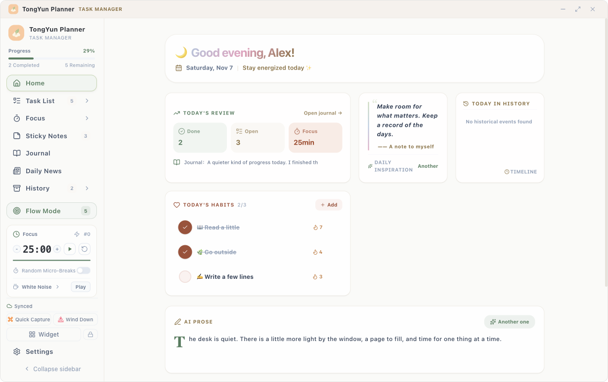
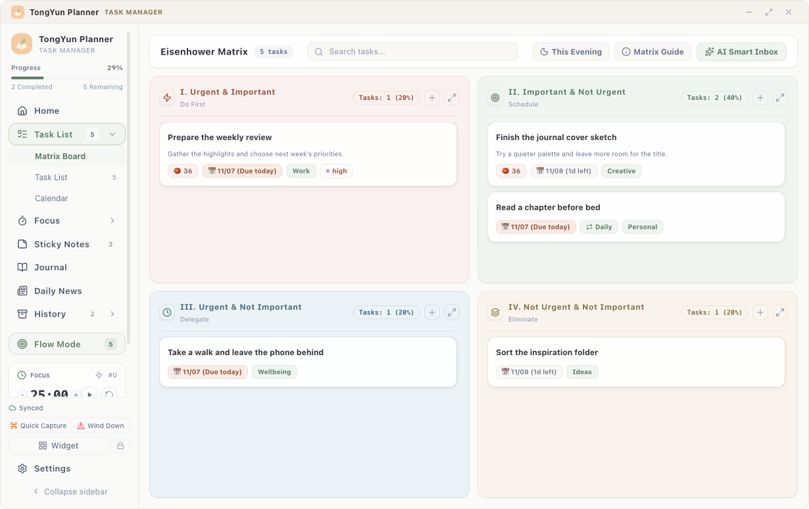
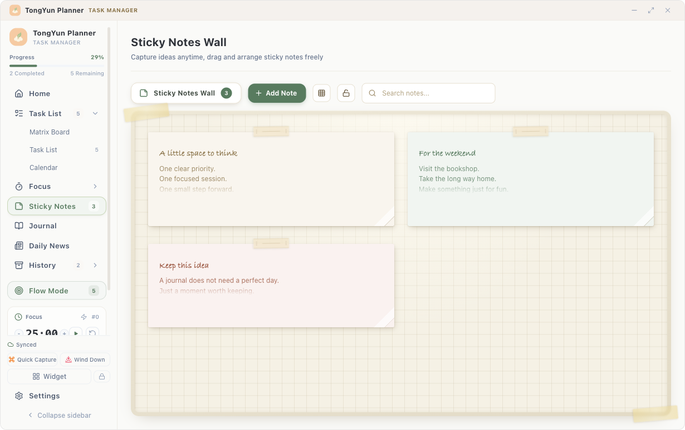
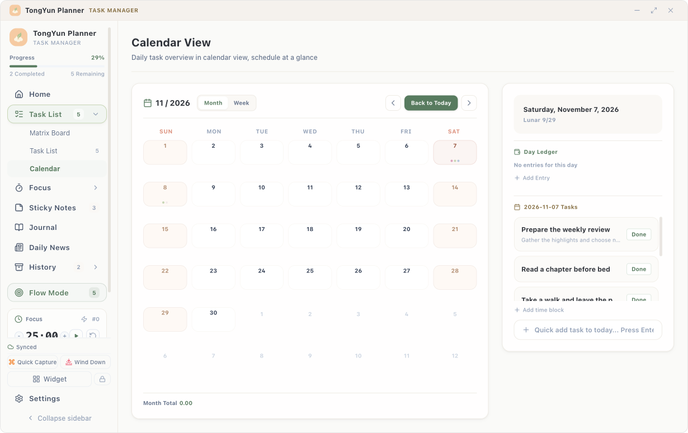
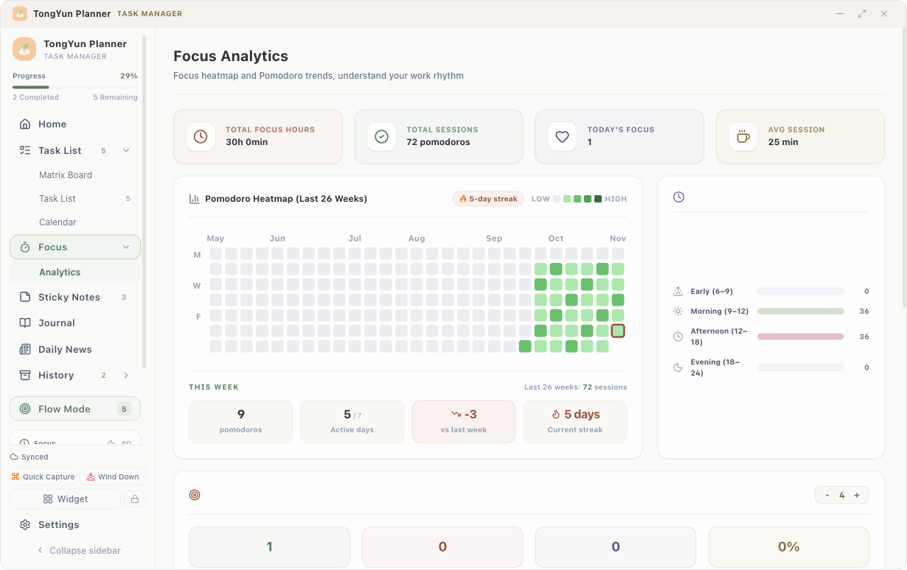

<div align="center">


# TongYun Planner

**Make room for what matters. Keep a record of the days.**

A local-first desktop journal for planning, writing, focusing, and looking back.

[简体中文](README.md) · **English**

[Download](https://github.com/dangzhuotong/tongyun-planner/releases/latest) · [Features](docs/FEATURES.md) · [Report an issue](https://github.com/dangzhuotong/tongyun-planner/issues)

[](https://github.com/dangzhuotong/tongyun-planner/releases/latest) [](LICENSE)

Windows · macOS · Linux



<sub>The feel of paper, with the convenience of a desktop app. Screenshots are illustrative; your installed version may differ.</sub>

</div>

## A little structure. A little space to breathe.

Start the morning with a few priorities. Settle into a focus session. Catch an idea on a sticky note. End the day with a journal entry and a look at what you have done.

TongYun Planner brings that routine into one app. Install it and use the core features locally, without an account. Add cloud sync or AI when you want them.

### Plan · Know your next step

Sort priorities in an Eisenhower matrix, then arrange tasks in a list or calendar. Subtasks, tags, recurring schedules, and due reminders help turn intentions into manageable steps.

### Write · Catch the moment

Save passing ideas on sticky notes, or write a journal entry with your mood and pictures. Date navigation, washi tape, stamps, and daily prompts add a small ritual to writing.

### Focus · One thing at a time

Start a pomodoro, choose some white noise, or enter a flow view that keeps the current task in front of you. A desktop widget keeps the timer close; micro-break reminders make room for a pause.

### Reflect · See what adds up

Explore your focus patterns with a heatmap. Revisit journal entries, completed tasks, and focus sessions in the memory timeline. A guided shutdown ritual helps you close the working day.

## A journal on your desktop

| Priorities | Sticky notes |
|:---:|:---:|
| [](screenshots/en/matrix-view.png) | [](screenshots/en/sticky-notes.png) |
| **Calendar** | **Focus statistics** |
| [](screenshots/en/calendar-view.png) | [](screenshots/en/analytics.png) |

Also included: sticky notes, countdowns, news and RSS reading, bookmarks, themes, fonts, dark mode, and a warm evening theme. [Explore the feature list →](docs/FEATURES.md)

## Local first. Connect on your terms.

| What you need | How it works |
|:---|:---|
| Use it without signing up | Core journal and planning features work locally and offline. No product account is required. |
| Work across devices | Connect your own WebDAV server, with a Nutstore preset available. When content conflicts, both copies are backed up for you to choose. |
| Keep your own backups | Import or export JSON and use daily desktop snapshots. Local image attachments must be copied separately when moving devices. |
| Get a little help from AI | Connect your model service for task organization, journal comments, suggestions, and reports. Relevant text is sent to that service when you use AI. |

API keys are excluded from sync by default and omitted from export snapshots. If you explicitly enable secret sync and set a passphrase, keys are encrypted before upload to your WebDAV. See the [feature list](docs/FEATURES.md) and [security notes](SECURITY.md) for storage and sync boundaries.

## Get started

Choose an installer from [GitHub Releases](https://github.com/dangzhuotong/tongyun-planner/releases/latest):

| Platform | Package |
|:---|:---|
| Windows | `.exe` installer or `.msi` |
| macOS | Universal `.dmg` for Apple Silicon and Intel |
| Linux | `.AppImage` or `.deb` |

Open **Settings → System & Language** to select English or Chinese and check for updates.

Installers do not currently have operating-system code signing or Apple notarization, so your system may show a warning on first launch. See the [installation guide](docs/INSTALLATION.md#english) for installation, upgrades, and backup migration.

<details>
<summary><strong>Build from source</strong></summary>

Built with Tauri 2 · React 19 · TypeScript · Rust · SQLite.

Use Node.js 22.12+, stable Rust, and the native build dependencies for your operating system.

```bash
git clone https://github.com/dangzhuotong/tongyun-planner.git
cd tongyun-planner
npm ci
npm run tauri build
```

In a managed local workspace, follow `AGENTS.md` and use the registered `tongyun-dev` entry to manage development services.

See [Contributing](CONTRIBUTING.md) for the workflow and [Architecture](ARCHITECTURE.md) for implementation details.

</details>

## Help shape the next page

TongYun Planner is an independently maintained open-source project, built with AI assistance. Bug reports, concrete use cases, and contributions are welcome.

[Report an issue](https://github.com/dangzhuotong/tongyun-planner/issues) · [Contribute](CONTRIBUTING.md) · [Changelog](CHANGELOG.md) · [FAQ](FAQ.md)

Supporting documentation is currently primarily in Chinese. The app supports Chinese and English.

Released under the [MIT License](LICENSE).
