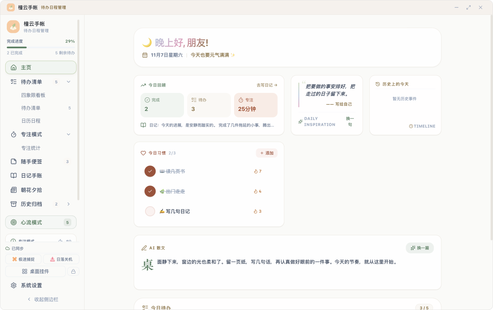

<div align="center">


# 橦云手帐

**把要做的事安排好，把走过的日子留下来。**

一款本地优先的桌面手帐，将待办、日记、专注与回顾放在同一个温暖的窗口里。

**简体中文** · [English](README.en.md)

[下载最新版](https://github.com/dangzhuotong/tongyun-planner/releases/latest) · [功能详单](docs/FEATURES.md) · [反馈问题](https://github.com/dangzhuotong/tongyun-planner/issues)

[](https://github.com/dangzhuotong/tongyun-planner/releases/latest) [](LICENSE)

Windows · macOS · Linux



<sub>纸张的质感，桌面的便利。界面示意，具体以安装版本为准。</sub>

</div>

## 给一天留出秩序，也留一点空白

早上，安排今天最重要的事；工作时，开启一轮专注；有灵感就记张便签；晚上，写几句日记，再回头看看今天的收获。

橦云手帐围绕这条日常路径设计。无需注册账号，下载安装后即可在本机使用；云同步和 AI 可以按需开启。

### 规划 · 看清下一步

在四象限里分清轻重缓急，在列表和日历里安排时间。子任务、标签、重复规则和到期提醒，帮你把想做的事变成可以推进的步骤。

### 记录 · 接住当下的想法

用便签收下转瞬即逝的灵感，在日记里记录正文、心情和图片。日期翻页、和纸胶带、印章与每日问答，让书写多一点仪式感。

### 专注 · 一次做好一件事

把任务交给番茄钟，选一段白噪音，或进入只呈现当前任务的心流模式。桌面挂件陪你计时，微休息提醒你适时停一停。

### 回顾 · 看见积累的分量

用专注热力图了解自己的节奏，在时光长廊翻看日记、已完成任务与专注记录。一天的收获，也可以成为日落关机仪式的起点。

## 窗口里的手帐

| 四象限规划 | 随手便签 |
|:---:|:---:|
| [](screenshots/matrix-view.png) | [](screenshots/sticky-notes.png) |
| **日历日程** | **专注统计** |
| [](screenshots/calendar-view.png) | [](screenshots/analytics.png) |

还有便签墙、倒数日、资讯订阅与稍后读，以及主题、字体、深色模式和日落暖色。[查看完整功能 →](docs/FEATURES.md)

## 本地优先，连接由你选择

| 你关心的事 | 橦云手帐的做法 |
|:---|:---|
| 不想注册账号 | 核心手帐功能可在本机离线使用，无需产品账号。 |
| 想在几台设备间使用 | 可选连接自己的 WebDAV，内置坚果云预设；真实冲突会保留两端副本供你选择。 |
| 想保留自己的备份 | 支持 JSON 导入导出和桌面端每日快照；搬迁图片时需另行保留附件目录。 |
| 想让 AI 帮一点忙 | 接入自己的模型服务，用于整理任务、日记暖评、建议与报告；调用时相关文本会发送给所选服务。 |

AI 密钥默认不同步，导出快照不含密钥。主动开启密钥同步并设置口令后，密钥才会加密上传至你的 WebDAV。同步范围和本机存储边界见[功能详单](docs/FEATURES.md)与[安全说明](SECURITY.md)。

## 开始使用

在 [GitHub Releases](https://github.com/dangzhuotong/tongyun-planner/releases/latest) 选择对应系统的安装包：

| 系统 | 安装包 |
|:---|:---|
| Windows | `.exe` 安装程序，或 `.msi` |
| macOS | Universal `.dmg`，支持 Apple Silicon 与 Intel |
| Linux | `.AppImage` 或 `.deb` |

首次打开后，可在 **设置 → 系统与语言** 切换中文或 English，并检查更新。

安装包尚未做操作系统代码签名与 Apple 公证，首次安装可能出现系统提示。安装、旧版升级和备份迁移说明见[安装指南](docs/INSTALLATION.md)。

<details>
<summary><strong>从源码构建</strong></summary>

技术栈：Tauri 2 · React 19 · TypeScript · Rust · SQLite。

建议使用 Node.js 22.12+、Rust 稳定工具链及对应系统的原生构建依赖。

```bash
git clone https://github.com/dangzhuotong/tongyun-planner.git
cd tongyun-planner
npm ci
npm run tauri build
```

本机受管工作区的服务启停遵循 `AGENTS.md`，使用已登记的 `tongyun-dev` 管理入口。

开发流程见[贡献指南](CONTRIBUTING.md)，实现细节见[架构说明](ARCHITECTURE.md)。

</details>

## 一起把它打磨得更好

橦云手帐是一个由个人维护、借助 AI 开发的开源项目。欢迎带着具体场景提建议，也欢迎提交修复。

[报告问题](https://github.com/dangzhuotong/tongyun-planner/issues) · [参与贡献](CONTRIBUTING.md) · [更新记录](CHANGELOG.md) · [常见问题](FAQ.md)

以 [MIT License](LICENSE) 开源。
