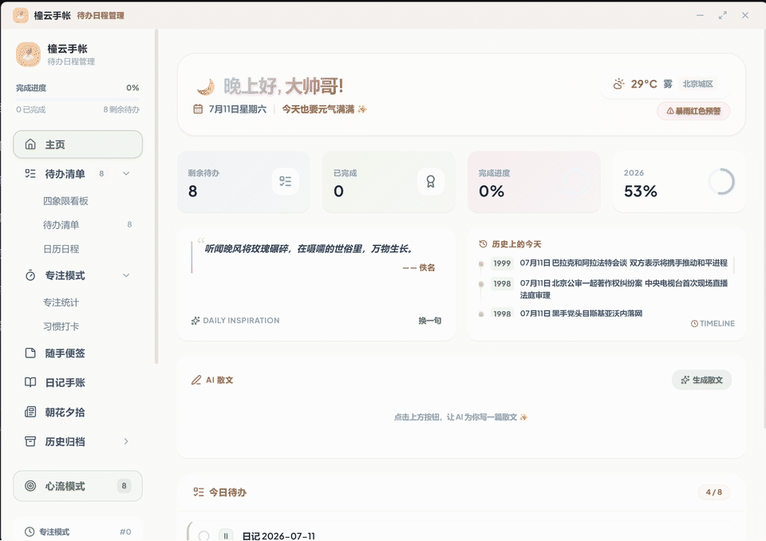
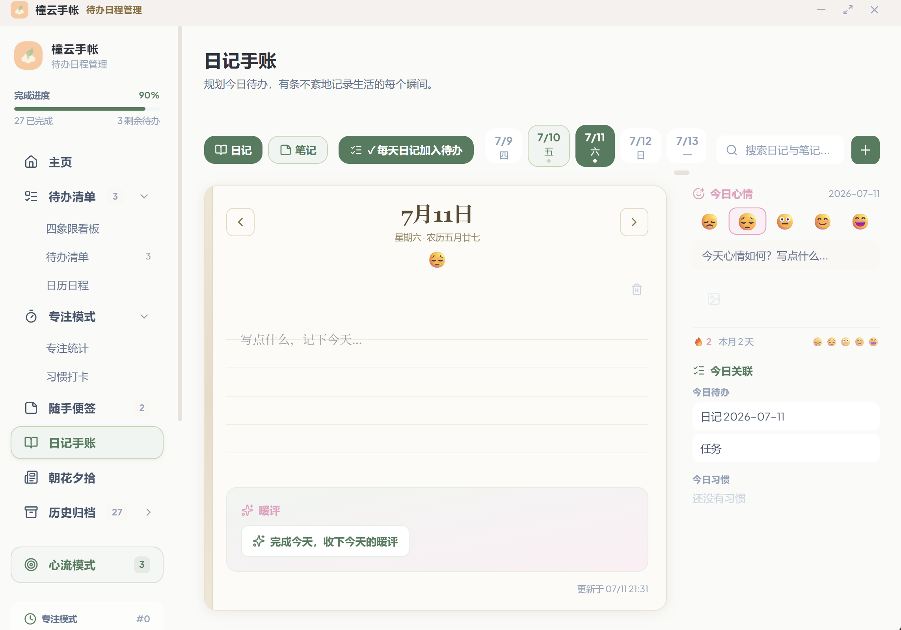
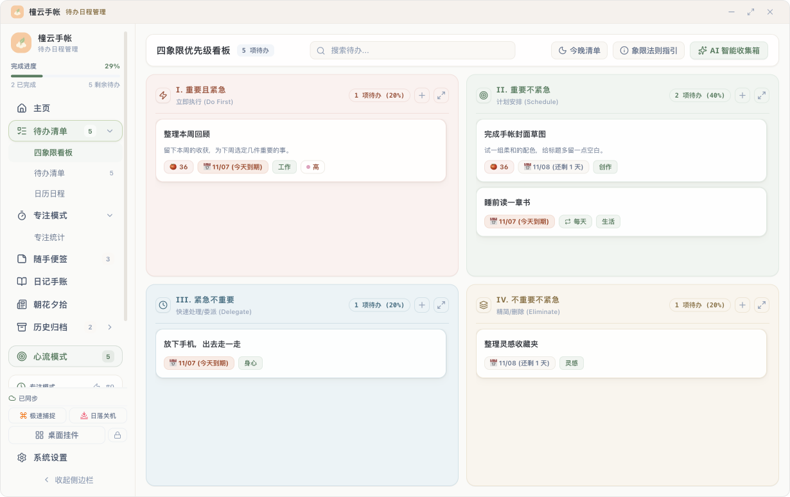
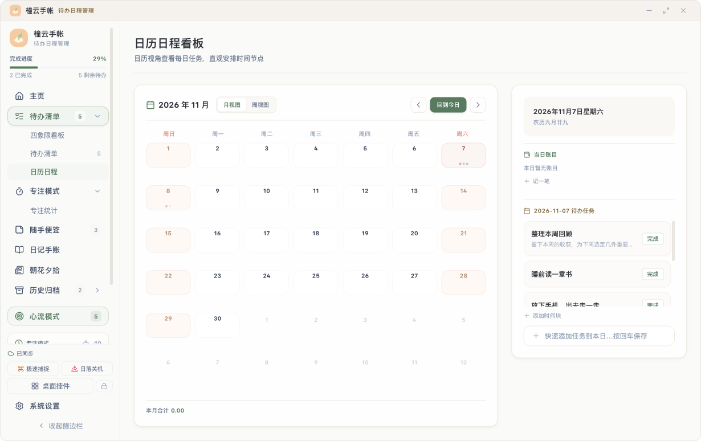
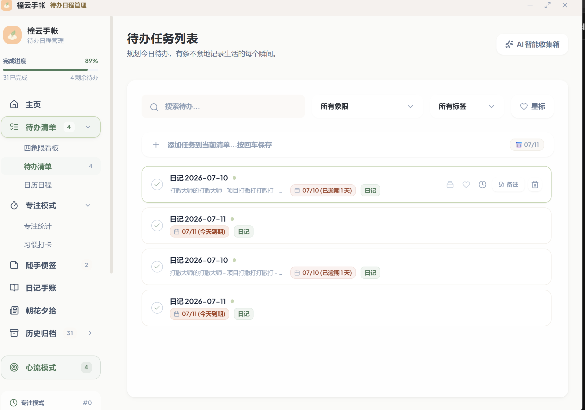
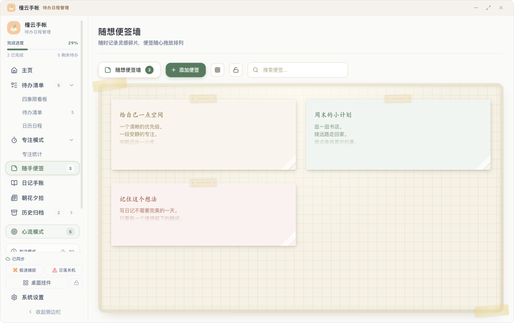
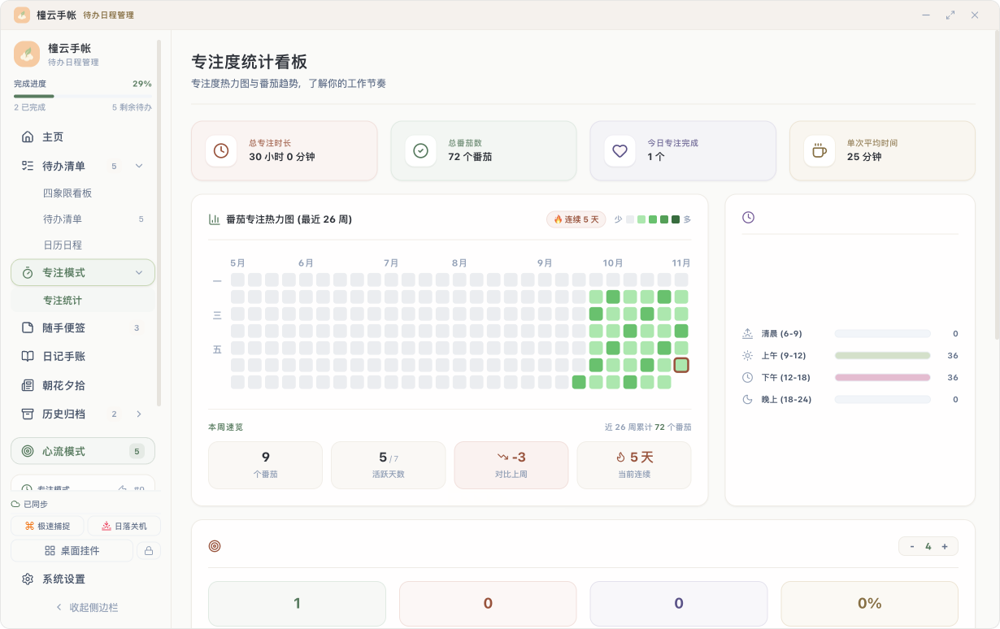
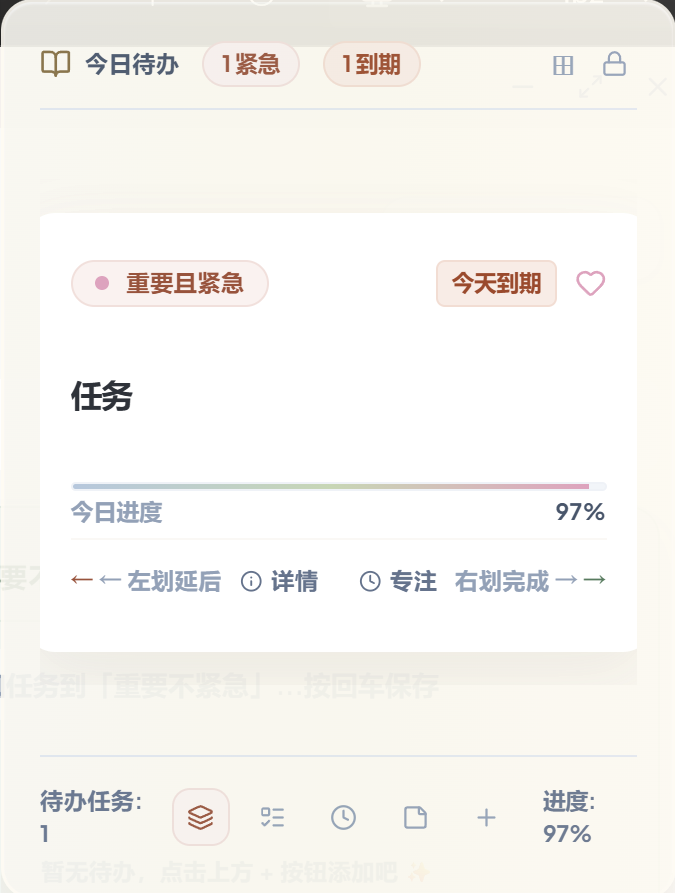
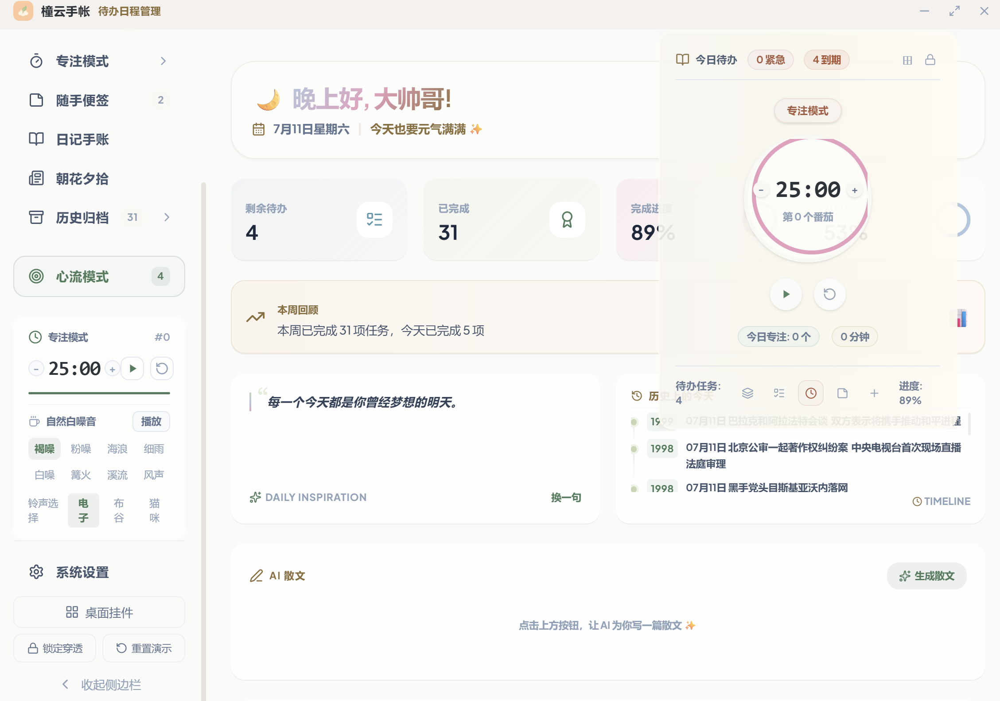
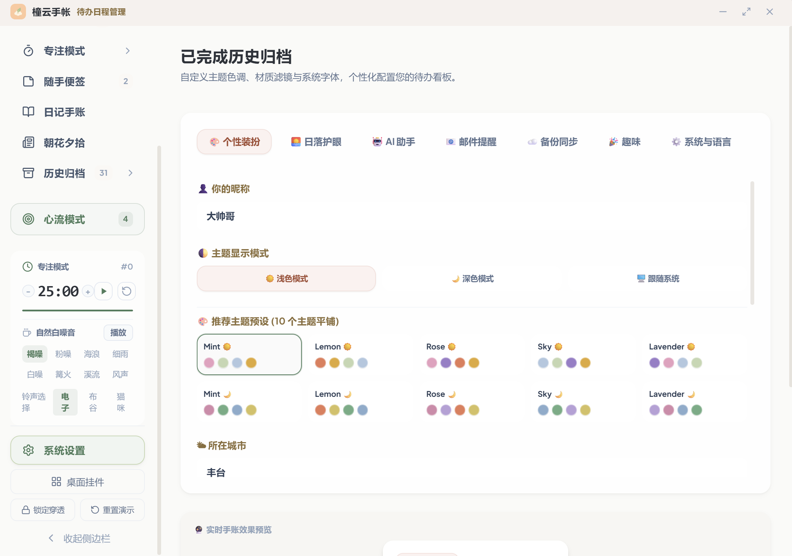

<div align="center">
  

  <h1>橦云手帐</h1>
  <p><strong>TongYun Planner</strong></p>
  <p>本地优先的桌面手帐：四象限待办 · 翻页日记 · 番茄钟 · 便签墙放在同一个窗口，数据默认只在你电脑上。</p>
  <p><em>A local-first desktop <strong>bullet journal app</strong> &amp; task manager — Eisenhower matrix, flip-page diary, pomodoro and sticky notes in one window. Offline, privacy-first, open source, no account required.</em></p>

  <p>
    <a href="https://github.com/dangzhuotong/tongyun-planner/releases/latest"><strong>⬇ 下载最新版</strong></a>
    &nbsp;·&nbsp; Windows · macOS Universal · Linux
  </p>

  <p>
    <a href="https://github.com/dangzhuotong/tongyun-planner/releases/latest"></a>
    <a href="LICENSE"></a>
    
    
    
  </p>
</div>

- **写给谁：** 想把日记写成仪式、又在意隐私的人——学生、上班族，或任何不想把日常交给云笔记的人。
- **解决什么：** 待办散落、日记没处写、资讯看完就忘。四象限任务、翻页日记、番茄钟和资讯一键存成待办，都在同一个本地窗口里。
- **有何不同：** 数据默认只在你的电脑上；日记是带书脊与横格的拟物手帐，而不是表单；可选 AI 给出克制的暖评，而不是催促你「更高效」。

**For English readers:** TongYun Planner is an open-source, privacy-first **desktop bullet journal app** and **offline diary app** for anyone who wants their to-do list and their diary inside one offline window. It ships an Eisenhower matrix, a paper-like flip-page journal, a pomodoro timer with white noise, sticky notes and a floating desktop widget — all stored in a zero-config local SQLite database. No sign-up, no cloud account, and **no server of ours that collects your notes**; optional multi-device sync goes through **your own WebDAV** (Nutstore preset included). If you want a Notion alternative that keeps your journal files on your own machine, this is one.

<div align="center">
  <br />
  <!-- 界面巡览动图：首页 → 四象限 → 翻页日记 → 便签墙 → 番茄钟（约 9s / 2.8MB / 960px） -->
  <a href="screenshots/dashboard.png" target="_blank" rel="noreferrer">
    
  </a>
  <p><sub>首页 · 四象限看板 · 翻页日记 · 便签墙 · 番茄钟（点击查看大图）</sub></p>
</div>

<details>
<summary><strong>English</strong></summary>

**TongYun Planner（橦云手帐）** is an open-source, privacy-first **local-first desktop bullet journal** and task app: Eisenhower matrix, flip-page diary, pomodoro timer with white noise, sticky notes, floating desktop widget, and optional AI comments. Built for people who want a paper-like ritual and keep their notes on their own machine — a **Notion alternative** for offline note-taking without an account. Powered by an out-of-the-box, zero-config local SQLite database, with strictly optional WebDAV sync.

[Download the latest installer](https://github.com/dangzhuotong/tongyun-planner/releases/latest) for **Windows**, **macOS Universal** (Apple Silicon and Intel), and **Linux** (AppImage / deb). The UI is Chinese by default, with a full English language pack in Settings.

</details>

---

## 界面

| 翻页日记 | 四象限看板 | 日历 |
|:---:|:---:|:---:|
|  |  |  |
| **待办列表** | **便签墙** | **专注统计** |
|  |  |  |
| **桌面挂件** | **番茄钟与白噪音** | **个性化设置** |
|  |  |  |

完整能力清单见 [docs/FEATURES.md](docs/FEATURES.md)。仓库根目录的 [docs/social-preview.png](docs/social-preview.png) 可上传到 GitHub Settings → Social preview（1280×640）。

### 适合哪些使用场景

- 用四象限、列表和日历安排待办，在同一窗口写日记、记便签和专注计时。
- 不注册产品账号，先在本机离线使用；有多设备需求时自行配置 WebDAV。
- 按需连接自己的 AI 服务。调用 AI、天气和资讯服务时，需要网络，相关内容会发送给所选第三方服务。

---

## 隐私与数据

- **默认本地优先与零配开箱。** 任务、日记、便签、番茄记录写在本机（SQLite / 应用数据目录）；零配置开箱即用，无需配置外部数据库或 DSN，作者没有运营收集这些内容的服务器。
- **同步是你自己开的。** 可选 WebDAV（内置坚果云预设，也可填自定义地址）同步。远端同步完全按需开启，主从关系与同步边界清晰；一旦开启，对应数据才会同步到**你配置的远端**。
- **AI 密钥与正文。** 密钥保存在本机设置里。使用 AI 时，相关文本会发往你填写的模型服务商。默认同步与导出快照会剥离 AI Key 等密钥。只有主动开启「同步 API 密钥」并设置口令时，密钥才会加密上传到你配置的 WebDAV；其他设备需要相同口令才能导入。WebDAV 密码与加密口令不上传。
- **天气。** 填写城市后，会请求第三方天气接口（当前为 `uapis.cn`），仅发送城市名。

**Privacy, in English:** your notes are stored locally by default. Tasks, diary entries, sticky notes and focus logs are written to a local SQLite database in your app data folder — offline-first, zero-config, no sign-up. The author runs no server that collects your content, and export snapshots omit API keys, and sync omits them by default. If you explicitly enable secret sync and set a passphrase, keys are encrypted before upload to your WebDAV. AI features send the relevant text to your chosen model service. Want multi-device sync? You turn on **your own WebDAV** and it goes nowhere else.

---

## 数据存储与同步

桌面端使用本机 SQLite（`tongyun_planner.db`），无需安装数据库服务或填写 DSN。任务、日记等使用领域表；现有实现也保留 localStorage、SQLite `storage` 兼容表和部分配置 JSON，尚不是完全移除 KV 的纯关系型架构。浏览器开发环境及 SQLite 不可用时会使用 localStorage 降级。

- **领域数据**：任务、日记、便签、番茄记录、倒数日、时间块和习惯等有对应领域表。领域仓库负责行级写入，部分本地设置通过兼容存储镜像到 SQLite。
- **跨设备同步**：当前由 `SyncEngine` 根据待上传分类、分类版本和 WebDAV 文件指纹工作。每个分类整包读写，使用远端 `manifest.json` 记录版本；不应把已建表的 `sync_outbox` 描述为当前 WebDAV 投递入口。
- **同步范围**：任务、已完成任务、便签、番茄记录、倒数日、日记和应用配置。记账条目包含在本地快照中；习惯、资讯收藏等不能理解为都会随 WebDAV 同步。
- **冲突保护**：日记条目内容相同、仅排列不同会自动确认；真实内容差异会保留两端备份后让你选择。远端数据读取失败时不会当成空日记覆盖本机。
- **附件与快照**：桌面日记图片保存为本地文件，JSON 中保存路径；跨设备同步或导入 JSON 不代表图片文件也已复制，搬迁时需要另行保留附件目录。任务附件有单独的存储后端设置。
- **密钥**：保存在本机配置中，不代表系统钥匙串或本地加密保险库。默认不参与云同步，手动导出与每日快照不含密钥；主动开启密钥同步时，使用口令派生密钥加密后上传。

迁移文件保存在 `migrations/`，运行时建表与数据迁移逻辑见 `src/data/domainDatabase.ts`。`agents`、`task_dispatch` 等兼容表的存在，不表示开源版提供 Agent 派活或远端 SQL 同步。

---

## 下载与安装

到 **[Releases · latest](https://github.com/dangzhuotong/tongyun-planner/releases/latest)** 取安装包：

| 系统 | 文件 |
|:---|:---|
| Windows（推荐） | `TongyunPlanner_*_x64-setup.exe` |
| Windows（MSI） | `TongyunPlanner_*_x64_en-US.msi` |
| macOS Universal | `TongyunPlanner_*_universal.dmg` |
| Linux | `.AppImage` 或 `.deb` |

安装包**未做代码签名**。Windows 可能出现 SmartScreen：「更多信息 → 仍要运行」。macOS 首次打开说明见下文。

### macOS 首次打开

说明：安装包没有 Apple 签名和公证，所以 macOS 首次打开会提示「Apple 无法验证 TongyunPlanner…」。三种解决办法：
1. 系统设置 → 隐私与安全性 → 往下找到提示，点「仍要打开」；
2. 在「应用程序」里右键点 App，选「打开」，再确认一次；
3. 终端执行：`xattr -dr com.apple.quarantine /Applications/TongyunPlanner.app`

**从 v1.0 升级：** 请手动下载并安装当前最新版。更新公钥已更换，v1.0 无法通过应用内更新跨过此次公钥迁移。装好新版后，后续版本可通过应用内检查更新。

### 已安装之后怎么更新

日常更新走应用里的检查更新。维护者不要在 Mac 上用当前开发 tip 重装给用户。

1. 打开 **设置 → 系统与语言**，看清「当前版本」。
2. 点 **检查更新**。有新版会下载并重启；已经是最新会提示「已是最新版本」。
3. 启动后也会静默检查，有新版同样弹窗。

新版本来自维护者推送的 tag `vX.Y.Z`（与 `package.json` / `tauri.conf.json` 版本一致）。GitHub Actions 会发布 Release，并带上更新器用的 `latest.json`。合进 main 不会自动发版。步骤见 [docs/RELEASE.md](docs/RELEASE.md)。

安装包在 CI 里用 **minisign** 签过更新包（`TAURI_SIGNING_*`）。**尚未做 Apple 公证**：首次安装仍可能要按上一节的 `xattr` 解除隔离（Release 说明里已写）。已经装上的 App 用检查更新换包。

安装后可在设置里切换 **中文 / English**。

---

## 从源码构建

适合改代码或打 Linux 包。需要 Node.js 20.19+ 或 22.12+（建议使用 Node.js 22.12+）、Rust，以及各系统的原生编译工具（Windows 需 VS C++ Build Tools；macOS 需 Xcode Command Line Tools）。

```bash
git clone https://github.com/dangzhuotong/tongyun-planner.git
cd tongyun-planner
npm install
npm run tauri build    # 产出安装包
```

本机工作区如果有 `AGENTS.md` 统一运行规则，开发服务必须通过已登记的 `tongyun-dev` / 已确认的管理入口启停，先核对项目目录、状态与环境。上面的构建命令不启动开发服务。普通独立环境的开发入口是 `npm run tauri dev`；受管工作区不要直接执行它。

常用脚本：`npm run typecheck`（类型检查）/ `npm test`（单元测试）/ `npm run check`（前端类型 + 单元测试 + Rust 编译全量检查）。

---

## 品牌 / 图标

官方主标叫「云芽」。色值：奶茶 `#FDC89C`、云 `#FCF4E1`、芽 `#A4C48C`。本 App 图标即主标。

各 App 变体规则与禁止事项见 [tongyun-scaffold/brand](https://github.com/dangzhuotong/tongyun-scaffold/tree/main/brand) 目录 README。

---

## 文档

- [功能详单](docs/FEATURES.md) · [发版](docs/RELEASE.md) · [更新日志](CHANGELOG.md) · [常见问题](FAQ.md)
- [贡献指南](CONTRIBUTING.md) · [安全说明](SECURITY.md) · [架构](ARCHITECTURE.md)

这是作者一个人、借助 AI 做出来的第一个桌面应用（Tauri 2 + React 19 + Rust）。遇到问题欢迎开 Issue；觉得有用的话，点个 Star 就是最大的鼓励。

本项目以 [MIT License](LICENSE) 开源。
